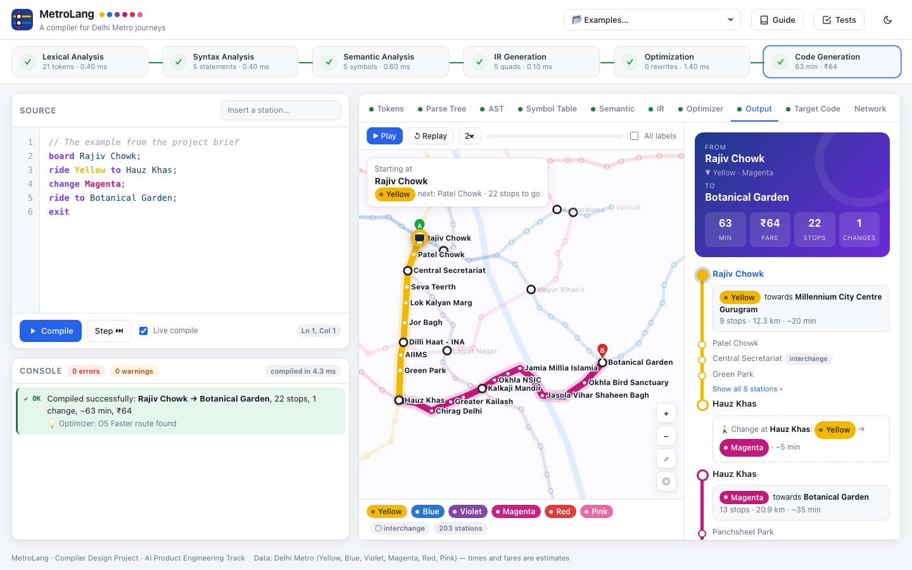
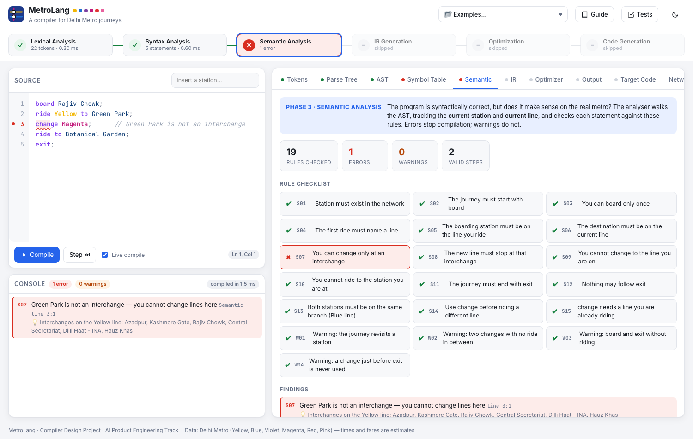
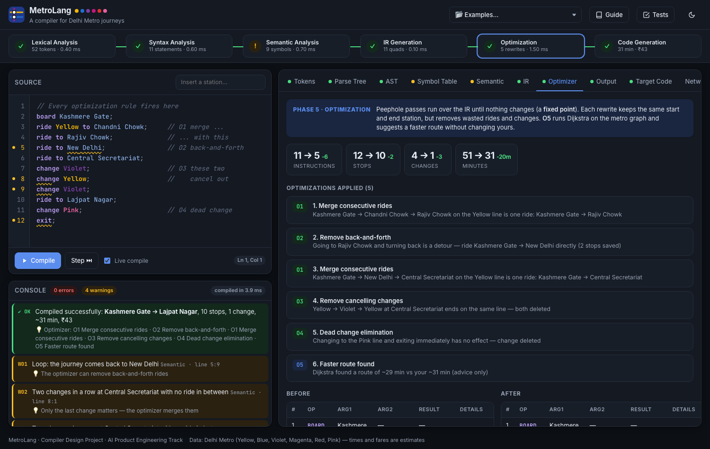

# 🚇 MetroLang: A Compiler for Delhi Metro Journeys

MetroLang is a small programming language for describing trips on the **Delhi Metro**, plus a complete compiler for it. You type a journey, and the app shows the output of **every compiler phase**: tokens, parse tree, AST, symbol table, semantic checks, intermediate code, optimization, and finally a **journey card with an animated train on a metro map**.

```
board Rajiv Chowk;
ride Yellow to Hauz Khas;
change Magenta;
ride to Botanical Garden;
exit
```

> Compiler Design Project · **AI Product Engineering Track** · plain HTML/CSS/JavaScript, no install needed.



---

## ✨ Features

| Area | What you get |
|---|---|
| **Real data** | 6 lines (Yellow, Blue + Vaishali branch, Violet, Magenta, Red, Pink), **203 stations**, 17 interchanges, taken from Wikipedia |
| **Phase 1: Lexer** | Token table, colour-coded token stream, regular definitions, line/column for each token |
| **Phase 2: Parser** | Recursive-descent parser, interactive **parse tree** and **AST** (pan, zoom, click a node to find it in the code) |
| **Phase 3: Semantic** | **Symbol table**, journey-state trace, **15 semantic rules + 4 warnings**, "Did you mean …?" suggestions |
| **Phase 4: IR** | Quadruples `(op, arg1, arg2, result)` and a three-address listing; adds direction, stops and stations in between |
| **Phase 5: Optimizer** | 4 peephole rules run to a fixed point, a before/after diff, and a **Dijkstra route advisor** |
| **Phase 6: Codegen** | Journey card (time, fare, stops), **animated 2D map** and **cinematic 3D view**, plain-English directions, **JSON e-ticket**, regenerated optimized source |
| **3D view** | Three.js scene with elevated glowing lines, a 3-coach train, and cinematic / chase / aerial / free cameras; daylight look in light mode, neon night look with bloom in dark mode |
| **Error handling** | Lexical, syntax and semantic errors with line:col, red squiggles, hints, and several errors reported at once |
| **UI** | Live compile while typing, pipeline status bar, **step-by-step mode**, 24 example programs, light/dark mode, works on phones |
| **Testing** | 81 automated tests (data integrity, every error code, every optimization, every example), runnable from the terminal or the UI |

---

## 🚀 How to run

**Option 1: just open it (no install).**
Double-click `index.html`, or drag it into Chrome, Edge, Firefox or Safari. That's all: everything runs in the browser.

**Option 2: local web server.**
```bash
cd cdPro
python3 -m http.server 8000
# open http://localhost:8000
```

**Option 3: GitHub Pages.** In the repository, go to *Settings → Pages → Deploy from branch → `main` / root*. The app is then live at `https://<user>.github.io/<repo>/`.

**Run the test suite** (needs Node.js ≥ 14, no packages):
```bash
node tests/run-tests.js
```

**Build:** no build or compile step. The source files are loaded directly by `index.html`.

**Dependencies:** none to install. The 3D view uses [Three.js](https://threejs.org) r147 (MIT), stored in `vendor/three/` so it also works offline. Fonts load from Google Fonts when online; otherwise system fonts are used.

**Using the 3D view:** open the **Output** tab and click **3D 🎬**. Pick a camera (Cinematic, Chase, Aerial or Free). Dragging the scene switches to the Free camera. The 2D map is always one click away.

---

## 📝 The MetroLang language

| Statement | Meaning |
|---|---|
| `board <station>;` | Start the journey at a station |
| `ride <Line> to <station>;` | Ride a line to a station (the first ride must name a line) |
| `ride to <station>;` | Keep riding the current line |
| `change <Line>;` | Change to another line (only at an interchange) |
| `exit;` | End the journey (the last `;` is optional) |
| `// …`, `# …`, `/* … */` | Comments |

- Station names can be written plainly (`Hauz Khas`) or quoted (`"Dilli Haat - INA"`). Matching ignores case and punctuation.
- Common short names work too: `INA`, `Red Fort`, `Pitampura`, `HUDA City Centre`, `Shaheed Sthal`, and others.
- Lines: `Yellow`, `Blue`, `Violet`, `Magenta`, `Red`, `Pink`.

### Grammar (BNF)
```
<program> ::= <stmt>* EOF
<stmt>    ::= <board> | <ride> | <change> | <exit>
<board>   ::= "board" <station> ";"
<ride>    ::= "ride" [ LINE ] "to" <station> ";"
<change>  ::= "change" LINE ";"
<exit>    ::= "exit" ";"
<station> ::= STRING | <part> { <part> }
<part>    ::= WORD | NUMBER | HYPHEN | COMMA | PAREN
```
Details are in [docs/grammar.md](docs/grammar.md).

---

## ⚙️ Compiler pipeline

```
 source ─► Lexer ─► Parser ─► Semantic ─► IR Gen ─► Optimizer ─► Code Gen ─► journey card + map
           tokens   parse tree  symbol table  quadruples  optimized IR   JSON / directions
                    + AST       + checks
```

| # | Phase | File | What it does |
|---|---|---|---|
| 1 | Lexical analysis | [src/lexer.js](src/lexer.js) | Regex-based scanner that produces tokens (KEYWORD, LINE, WORD, NUMBER, STRING, …) with line and column |
| 2 | Syntax analysis | [src/parser.js](src/parser.js) | Recursive-descent parser that builds the parse tree and AST, with phrase-level and panic-mode recovery |
| 3 | Semantic analysis | [src/semantic.js](src/semantic.js) | Walks the AST with the passenger state (station, line) and checks it against the network symbol table |
| 4 | IR generation | [src/irgen.js](src/irgen.js) | Produces `BOARD / RIDE / CHANGE / EXIT` quadruples with direction, stops and the stations in between |
| 5 | Optimization | [src/optimizer.js](src/optimizer.js) | Peephole passes O1–O4 run to a fixed point; O5 is a Dijkstra route advisor |
| 6 | Code generation | [src/codegen.js](src/codegen.js) | Journey summary, animation path, directions and JSON e-ticket |
| — | Network / symbols | [src/network.js](src/network.js) | Graph of stations and lines, name lookup, edit-distance suggestions, shortest path |
| — | Driver | [src/compiler.js](src/compiler.js) | Runs the phases in order and stops after a phase that reports errors |

### Error handling

| Phase | Codes | Examples |
|---|---|---|
| Lexical | L01–L04 | illegal character `@`, unterminated string, unterminated comment, empty `""` |
| Syntax | P01–P10 | missing `;`, missing `to`, unknown line `Yelow` (*did you mean Yellow?*), unknown statement `bord`, `change` without a line, empty program |
| Semantic | S01–S15 | unknown station (*did you mean Rajiv Chowk?*), `change` at a station that is not an interchange, line doesn't stop here, station not on the current line, Blue branch with no direct train, missing `exit`, … |
| Warnings | W01–W04 | journey loops back, two changes in a row, change right before exit |



### Optimizations

| Rule | Rewrite |
|---|---|
| **O1** Merge rides | `RIDE L A→B ; RIDE L B→C` (same direction) ⇒ `RIDE L A→C` |
| **O2** Remove detour | `RIDE L A→B ; RIDE L B→C` (direction flips) ⇒ `RIDE L A→C`, or deletes both rides if `C = A` |
| **O3** Merge changes | `CHANGE x→y ; CHANGE y→z` ⇒ `CHANGE x→z` (both deleted if `x = z`) |
| **O4** Dead change | `CHANGE x→y ; EXIT` ⇒ `EXIT` |
| **O5** Route advisor | Dijkstra over (station, line) states with a 5-minute change penalty suggests a faster route (advice only) |



---

## 📁 Project structure

```
cdPro/
├── index.html              ← the app (open this)
├── css/style.css           ← UI styles (light + dark)
├── data/metro-data.js      ← 6 lines, 203 stations, aliases, map coordinates, fare slabs
├── src/                    ← the compiler
│   ├── lexer.js  parser.js  semantic.js  irgen.js  optimizer.js  codegen.js
│   ├── network.js          ← metro graph, lookup, Dijkstra
│   └── compiler.js         ← pipeline driver
├── ui/                     ← the interface
│   ├── app.js              ← wiring, tabs, pipeline bar, step mode
│   ├── editor.js           ← syntax-highlighted editor (colours come from the lexer)
│   ├── treeView.js         ← parse tree / AST drawing
│   ├── mapView.js          ← 2D metro map + train animation
│   ├── map3d.js            ← cinematic 3D view (Three.js)
│   ├── panels.js           ← each phase tab
│   └── panzoom.js
├── vendor/three/          ← Three.js r147 (MIT), loaded only when 3D is opened
├── examples/examples.js    ← 24 example programs (valid + every error type)
├── tests/                  ← cases.js (shared) + run-tests.js (Node runner)
├── docs/                   ← grammar, viva notes, screenshots
├── AI_WORKFLOW.md          ← how Generative AI was used to build this
└── PLAN.md                 ← the original project plan
```

---

## 🧪 Testing

`node tests/run-tests.js` runs:
- **8 data-integrity checks**: 6 lines, 200+ stations, every interchange on 2 or more lines, every alias valid, no duplicates, the network is connected, …
- **49 compiler tests**: valid journeys with exact stop counts and directions, every lexical, syntax and semantic error code, every warning, every optimization rule.
- **24 example programs**, each checked to behave as its group says.

The same suite runs inside the app (**Tests** button). Click a test to load it into the editor.

---

## 📊 Data and estimates

- Station order and interchanges come from the Wikipedia article for each line (Nov 2026).
- **Simplifications:** the Pink Line is modelled as Majlis Park → Shiv Vihar (its 2026 ring-closing section is left out), the Magenta Line as Krishna Park Extension → Botanical Garden, and only interchanges between these 6 lines are included.
- **Time** = stops × (average km per stop ÷ 36 km/h) + 5 min per change + 3 min to enter and exit.
- **Fare** = DMRC distance slabs (₹11 / 21 / 32 / 43 / 54 / 64). Both time and fare are clearly labelled as estimates.
- Map positions are approximate coordinates, used only for drawing.

---

## 👥 Team: Semester Survivors

| Member | Compiler phase(s) | Other modules |
|---|---|---|
| **Raman Luhach** (Team Lead) | Syntax analysis (`src/parser.js`), Semantic analysis (`src/semantic.js`) | App controller (`ui/app.js`), 3D map (`ui/map3d.js`), plan, report |
| **Ritesh Patil** | Lexical analysis (`src/lexer.js`) | Grammar spec, network graph + Dijkstra (`src/network.js`), compiler driver (`src/compiler.js`), examples |
| **Meghavi Rao** | Optimization (`src/optimizer.js`) | Editor and phase panels (`ui/editor.js`, `ui/panels.js`), 2D map (`ui/mapView.js`, `ui/panzoom.js`), report figures |
| **Rachit Kumar** | Code generation (`src/codegen.js`) | Styling (`css/style.css`), viva notes, screenshots |
| **Harshal Nerpagar** | Intermediate code generation (`src/irgen.js`) | Metro dataset (`data/metro-data.js`), tree view (`ui/treeView.js`), test runner |

The project report (IEEE format) is in [report/report.pdf](report/report.pdf).

---

## 🔭 Future scope

- All Delhi Metro lines (Green, Grey, Aqua, Airport Express, Golden) and the full Pink Line ring.
- Live fares and timings from an official API, and a shortest-distance fare.
- More targets: printable PDF ticket, QR code, and voice directions.
- Hindi keywords (`chadho`, `badlo`, `utro`) and multilingual station names.
- Time-aware semantics (first and last train, peak hours) and accessibility routing (lifts only).

---

## 🤖 Use of Generative AI

This project was built on the **AI Product Engineering Track**, using an AI coding agent for research, design, implementation and verification. The full process is in [AI_WORKFLOW.md](AI_WORKFLOW.md).
